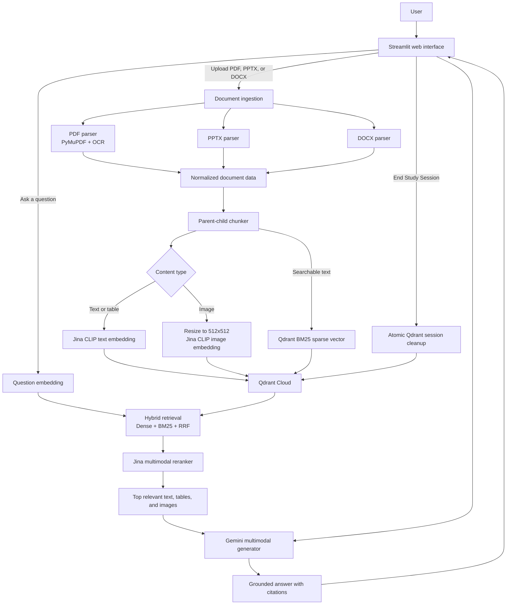

# UNILLM

## A study assistant that understands your documents

UNILLM is a multimodal Retrieval-Augmented Generation (RAG) application for
students, researchers, and anyone who wants to ask questions about their own
learning material.

Upload a PDF, PowerPoint presentation, or Word document. UNILLM extracts the
document's text, tables, diagrams, and images, then makes that material
searchable. When you ask a question, it finds the most relevant sources and
uses them to generate a grounded answer with citations.

The goal is simple: instead of searching through long notes manually, you can
have a conversation with the material you already trust.

## Why the project is useful

Traditional keyword search can miss a relevant passage when the wording in
your question is different from the wording in the document. UNILLM combines
several kinds of understanding:

- **Semantic search** finds content with a similar meaning.
- **BM25 keyword search** catches exact terms, names, and technical phrases.
- **Reranking** evaluates the strongest candidates more carefully.
- **Multimodal processing** keeps useful information from tables, diagrams,
  and images instead of treating a document as text only.
- **Citations** show which retrieved sources support the answer.

This makes the application useful for revision, research notes, technical
documents, lecture slides, and visual study material.

## How it works



### The upload path

1. The parser reads the uploaded file and produces one consistent data format.
2. Text, tables, and images are separated into searchable child chunks.
3. Each unique text chunk and image receives an embedding.
4. Text is also stored with a Qdrant BM25 representation.
5. Chunks are saved with a session ID so one user's study session is isolated
   from another's.

### The question path

1. The question is embedded as a search vector.
2. Qdrant performs dense vector search and sparse BM25 search.
3. Reciprocal Rank Fusion (RRF) combines both result lists.
4. Jina reranks the best candidates, including visual candidates when present.
5. Gemini receives the selected sources and produces a cited answer.

Each `[Source N]` citation in an answer maps to a readable source entry such
as `lecture-notes.pdf - Page 4`, `lecture-slides.pptx - Slide 7`, or
`reading.docx - Paragraph 12`. Internal IDs remain available to the
application for tracing, but they are not shown as raw JSON to users.

## Technology stack

| Area | Technology |
| --- | --- |
| User interface | Streamlit |
| Text and image embeddings | Jina `jina-clip-v2` |
| Reranking | Jina `jina-reranker-m0` |
| Answer generation | Google Gemini through `google-genai` |
| Vector database | Qdrant Cloud |
| PDF parsing and OCR | PyMuPDF and Tesseract |
| PowerPoint parsing | `python-pptx` |
| Word parsing | `python-docx` |
| Image processing | Pillow |
| Runtime | Python 3.10+ |

## Getting started

### 1. Clone the repository

```powershell
git clone https://github.com/Hiteshpydev/UNILM-.git
cd UNILM-
```

### 2. Create and activate a virtual environment

Windows PowerShell:

```powershell
python -m venv venv
.\venv\Scripts\Activate.ps1
```

### 3. Install dependencies

```powershell
pip install -r requirements.txt
```

### 4. Install Tesseract OCR

Install Tesseract OCR separately and make sure the executable is available at:

```text
C:\Program Files\Tesseract-OCR\tesseract.exe
```

The PDF OCR integration currently uses this Windows path.

### 5. Configure API credentials

Copy `.env.example` to `.env` and add credentials for the services:

```dotenv
GEMINI_API_KEY=your_gemini_api_key
QDRANT_URL=https://your-qdrant-cluster-url
QDRANT_API_KEY=your_qdrant_api_key
JINA_API_KEY=your_jina_api_key
```

Do not commit `.env` or share API keys.

### 6. Start the application

```powershell
streamlit run app\app.py
```

Open the local URL shown by Streamlit, upload your study material, and ask a
question.

## Embedding and cost behavior

Images are normalized to 512x512 RGB before embedding and before being sent to
the reranker. This keeps visual requests predictable instead of sending large
original image files.

Embeddings are cached locally in:

```text
data\embedding_cache.sqlite3
```

The cache is keyed by model, input type, dimensions, and content hash. If the
same text or image is processed again, the application reuses the saved vector
instead of making another Jina embedding request.

## Session isolation and cleanup

Every study session receives a unique UUID. That ID is attached to every
Qdrant point and applied as a retrieval filter. This prevents results from
another session from appearing in the current conversation.

When the user clicks **End Study Session**, UNILLM:

1. Deletes the session's Qdrant points with an atomic payload filter.
2. Waits for the Qdrant operation to complete.
3. Verifies that no matching points remain.
4. Removes extracted image files.
5. Clears the Streamlit session state and starts a new session.

The success message must appear before the browser is closed or refreshed.
Closing a browser tab does not run server-side Streamlit Python code, so it
cannot trigger cleanup by itself.

## Project structure

```text
UNILM-/
├── app/
│   ├── app.py                       # Streamlit application
│   ├── chunking/
│   │   └── chunker.py               # Parent-child chunking
│   ├── embeddings/
│   │   └── embedder.py              # Jina embeddings and local cache
│   ├── generation/
│   │   └── generator.py             # Gemini answer generation
│   ├── ingestion/
│   │   ├── ingestion_manager.py     # File-type router
│   │   ├── pdf_parser.py            # PDF, OCR, table, and image parsing
│   │   ├── pptx_parser.py           # PowerPoint parsing
│   │   └── docx_parser.py           # Word parsing
│   └── retrieval/
│       ├── indexer.py               # Chunk embedding and indexing
│       ├── retriever.py             # Hybrid search and RRF
│       ├── reranker.py              # Jina multimodal reranking
│       └── vector_store.py          # Qdrant connection and cleanup
├── data/                            # Local cache location
├── extracted_images/                # Runtime image extraction directory
├── tests/                            # Regression and component tests
├── .env.example                     # Environment variable template
├── requirements.txt                 # Python dependencies
└── README.md
```

## Running tests

Run the focused regression tests from the repository root:

```powershell
python -m unittest tests.test_embedder tests.test_reranker tests.test_vector_store_cleanup -v
```

The tests cover image resizing, embedding-cache reuse, reranker image
normalization, and Qdrant session deletion.

## Troubleshooting

### No answer is generated

- Confirm that all API keys are present in `.env`.
- Confirm that the uploaded file contains extractable text or images.
- Check the Streamlit terminal for the exact service error.

### Images are not extracted

- Confirm that the file contains embedded images rather than only visual
  content rendered in an unsupported format.
- Check that `extracted_images/` is writable.

### Points remain in Qdrant

- Press **End Study Session** and wait for the success message.
- Check that `QDRANT_URL` and `QDRANT_API_KEY` point to the expected cluster.
- If cleanup reports an error, keep the error message; it identifies the failed
  Qdrant operation.

## Privacy and security

- API keys belong only in `.env` or the deployment platform's secret store.
- Uploaded files and extracted images are local runtime data.
- Qdrant retrieval is filtered by session ID.
- Source material is sent to external AI services when embedding, reranking,
  or generating an answer, so deployment owners should review the privacy
  policies of those services before using sensitive documents.
